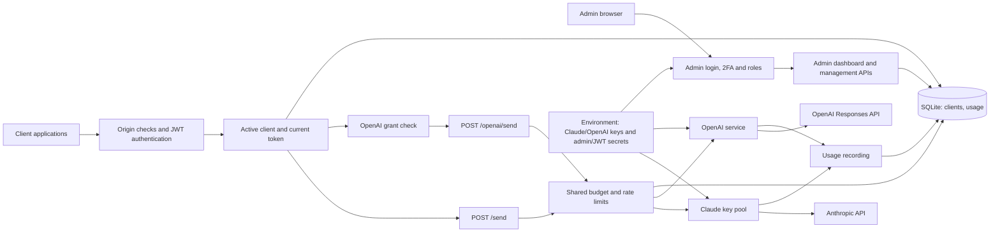
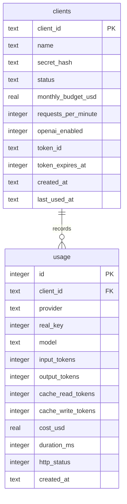

# GenAI Gateway: architecture

One Node.js process serves Claude and OpenAI behind the same authentication, client database, limits, and admin dashboard. Paths below are relative to `/api/assistant`.

## System context



## Modules

| Module | Responsibility |
|---|---|
| `src/server.ts` | Configuration, JWT login/hooks, grants, shared limits, all routes and usage recording |
| `src/claude.ts` | Existing Anthropic SDK streaming-to-final-message flow, key rotation/failover, Claude pricing |
| `src/openai.ts` | `OpenAIError`, `createOpenAIService`: environment key pool, REST calls and cost calculation |
| `src/db.ts` | `openDb`, client/key queries, migration, usage insertion and summaries |
| `src/admin.html` | Existing style/components, shared login, clients, provider totals, key controls and request details |
| `src/totp.ts` | Authenticator setup, verification and replay prevention |

## Authentication and authorization

`POST /token` verifies admin credentials from the environment or client secret hashes from SQLite. Admin login also checks configured TOTP. Any source IP can sign in with valid credentials; there is no IP allowlist. Login failures still feed a per-IP lockout. HS256 is pinned; JWTs contain `sub`, `role`, and `jti`.

Client login checks credentials and active status before returning any session information. An unexpired token produces `409` with `expiresAt` and `retryAfterSeconds`, without returning or replacing the token. Otherwise the gateway signs a JWT and atomically claims the client's token slot only if no token exists or its stored expiry has passed. The conditional update also checks the secret hash and active status, preventing concurrent logins from issuing two usable tokens or bypassing secret rotation/disablement. The stored Unix-second expiry and response `expiresAt` come from the signed JWT's `exp` claim. No raw JWT is stored. `ONE_TOKEN_PER_CLIENT` is no longer used.

`requireClient` verifies JWT expiry, client role, the current active client row, and current token ID. `requireOpenAI` additionally checks `openai_enabled`. No provider grant is embedded in JWTs: revocations apply immediately to the next request. Rotating a secret revokes its current token and clears the expiry lock, allowing immediate recovery. Admins use client accounts to send prompts; successful admin login still replaces the previous admin session.

All management routes inherit `requireAdmin`: JWT verification, admin role and current admin session ID. This includes OpenAI key endpoints. Admin pages/APIs get no-store and browser hardening headers. User-supplied names and labels are rendered using DOM text nodes.

## OpenAI request sequence

```mermaid
sequenceDiagram
    participant C as Client
    participant G as Gateway
    participant D as SQLite
    participant O as OpenAI
    C->>G: POST /openai/send + existing client JWT
    G->>D: Read client status, token ID and OpenAI grant
    G->>G: Validate prompt and check shared limits
    G->>G: Select ready key from environment pool loaded at startup
    G->>O: POST /v1/responses with Bearer key and store:false
    O-->>G: Output blocks, status and usage
    G->>G: Validate response and calculate cached/uncached cost
    G->>D: INSERT usage(provider=openai); update last_used_at
    G-->>C: Normalized output/usage or refusal with usage
```

The service uses native `fetch`, a bounded abort timeout and no redirect following. It supports synchronous text responses. It aggregates all message text blocks rather than assuming the first output item is text. Output truncation is surfaced through `stopReason`; refusals return `422`. Invalid responses and network errors produce sanitized `502` errors.

OpenAI input tokens include cache reads. Stored `input_tokens` excludes those cache reads; `cache_read_tokens` records them separately. Output includes any billed reasoning tokens already present in upstream usage. The configured model's verified price determines cost; OpenAI cannot silently use a model without configured pricing.

## Data model and migration



`real_key` identifies a key within its provider. OpenAI IDs are the numbers in `OPENAI_KEY_1` through `OPENAI_KEY_5`; blank slots are skipped without renumbering. Both providers read keys from the environment. Usage has no key foreign key. Replacing a key in a slot keeps that slot’s reporting history; clearing a slot and restarting stops using it.

Startup creates tables/indexes and adds missing `token_id`, `token_expires_at`, `openai_enabled`, and `usage.provider` columns. Adding `token_expires_at` and clearing legacy token IDs happen in one transaction: their expiry was never stored, so existing client tokens are revoked once. Later starts preserve both token ID and expiry. IDs, secret hashes, limits, existing grants and usage remain intact. Old clients without grants default to no OpenAI access; historical usage defaults to `anthropic`. WAL and foreign keys remain enabled. Indexes on `(client_id, created_at)` and `created_at` support limits and reports.

Client summaries and `/me/usage` combine providers. Admin usage accepts an optional provider filter and a provider grouping. Key groups include both provider and numeric ID, preventing collisions. The dashboard renders separate provider totals and key tables.

## Keys, retries and operational state

OpenAI keys are configured only in `OPENAI_KEY_1` through `OPENAI_KEY_5`. The server loads and validates nonempty slots at startup. Keys stay in memory; only masked suffixes, slot IDs and readiness are returned to the admin. There are no key-write APIs or dashboard entry controls. Existing `openai_keys` database rows are left intact but ignored, and `OPENAI_KEY_ENCRYPTION_SECRET` is no longer used. No migration copies keys out of SQLite.

Configured ready keys rotate. Explicit 429 responses rest for Retry-After seconds (30 seconds by default, capped at one hour); 401/403 rest five minutes, 5xx ten seconds. The service retries another ready key for these responses, skips cooling keys, and does not replay timeouts, disconnects, malformed responses, or ordinary 4xx requests. Configuration changes require a restart. Provider limits may be shared across keys.

In memory: rate windows, login failures, admin session ID, TOTP replay state, key rotation cursors and cooldowns. Restart resets these. SQLite preserves client tokens/grants and usage; keys reload from the environment. One process is supported; multi-process deployments require shared coordination.

Budget checks use completed recorded spend and do not reserve in-flight cost. An individual or concurrent call can exceed the remaining allowance. Errors without known upstream usage record zero estimated cost, so provider billing remains the reconciliation source. In-flight calls may finish after grant changes.

Use HTTPS and a controlled reverse proxy. Back up SQLite with its backup mechanism and keep a separate secure backup of `.env`. Never commit provider keys or return them through the API. See [DEPLOY.md](DEPLOY.md).
