# Claude Gateway: Architecture

This document explains how the gateway is built, at two levels of detail, and walks through the main flows step by step.

- **Part 1, HLD (high-level design):** the big boxes and how they talk.
- **Part 2, LLD (low-level design):** the code modules, the request pipeline, the data model, and the key pool.
- **Part 3, sequence diagrams:** what happens, in order, for each main flow.

---

## Part 1: High-level design (HLD)

### 1.1 System context

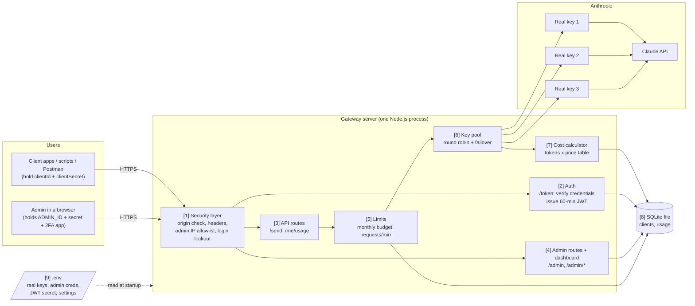

### 1.2 What each box does

| # | Component | Responsibility | Lives in |
|---|---|---|---|
| 1 | Security layer | Rejects browser calls from unknown sites; adds security headers; hides admin from non-allowed IPs; blocks IPs after repeated failed logins | `src/server.ts` (hooks) |
| 2 | Auth | Checks client ID + secret (or admin ID + secret + 2FA code) and signs a short-lived JWT | `src/server.ts` (`/token`), `src/totp.ts` |
| 3 | API routes | `/send` forwards a prompt to Claude; `/me/usage` shows a client its spend | `src/server.ts` |
| 4 | Admin routes | Create, update, disable and rotate clients; usage reports; serves the dashboard page | `src/server.ts`, `src/admin.html` |
| 5 | Limits | Stops a client over its monthly budget (402) or per-minute limit (429) before any cost is spent | `src/server.ts` (`enforceLimits`) |
| 6 | Key pool | Picks the next real Anthropic key; on rate limit or outage, rests that key and retries on the next | `src/claude.ts` |
| 7 | Cost calculator | Turns token counts into US dollars using the price table | `src/claude.ts` |
| 8 | SQLite | Persists clients (secret **hashes** only) and one usage row per request | `src/db.ts`, `data/gateway.db` |
| 9 | `.env` | Configuration and secrets; never sent to clients | project root |

### 1.3 Trust boundaries

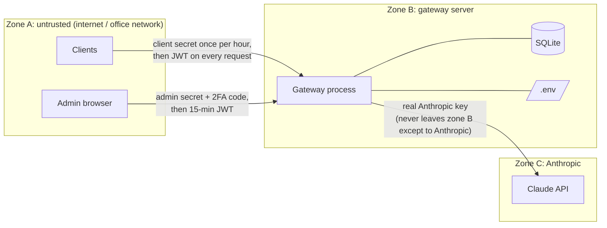

- Real Anthropic keys exist only in zone B and are sent only to Anthropic.
- Client secrets cross from zone A once (at login) and are stored only as SHA-256 hashes.
- Everything after login uses a signed token that expires (60 min for clients, 15 min for the admin).

---

## Part 2: Low-level design (LLD)

### 2.1 Modules and their main functions

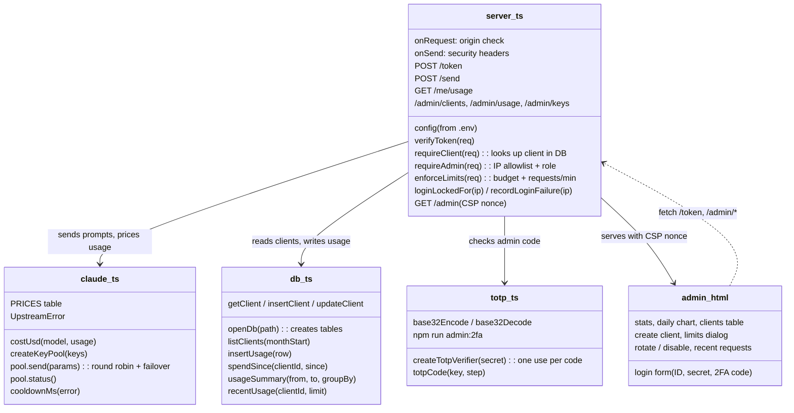

### 2.2 Request pipeline for `POST /send`

Fastify runs these stages in a fixed order. Any stage can stop the request with an error; nothing reaches Anthropic until stage 7.

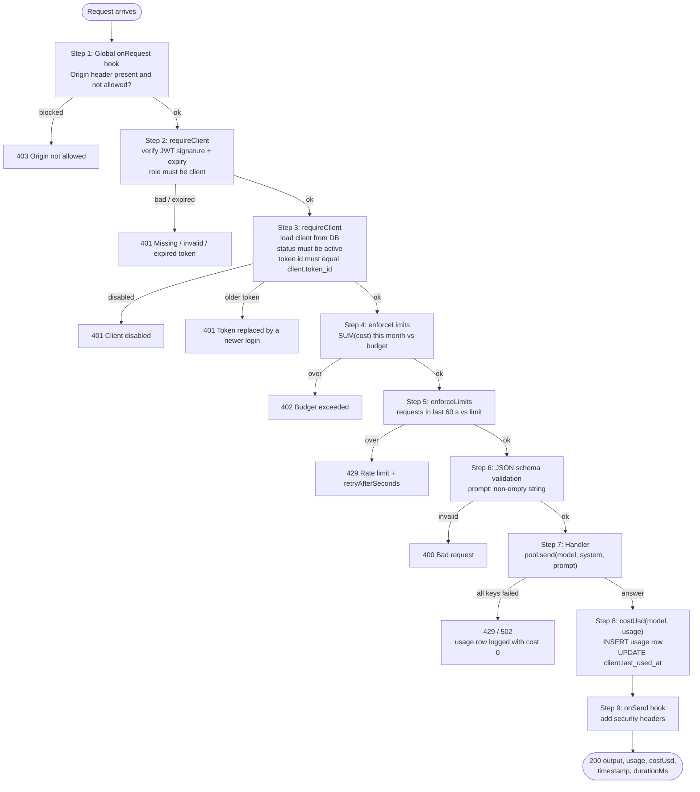

### 2.3 `POST /token` logic

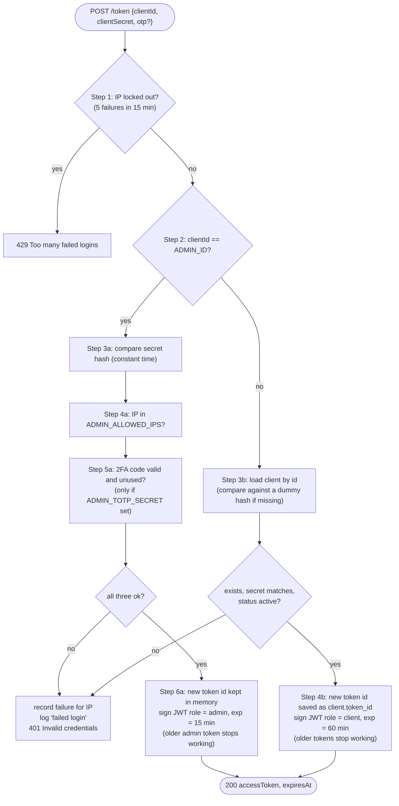

The error is always the same `401 Invalid credentials`, so a guesser can't tell whether the ID, the secret, the 2FA code or the IP was wrong.

### 2.4 Data model

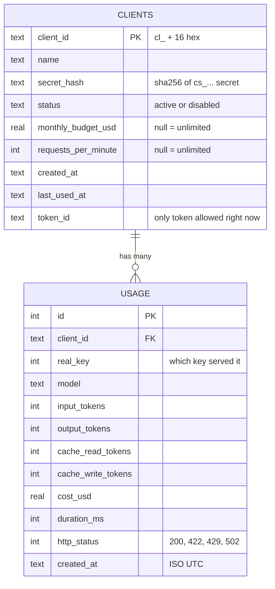

Indexes: `usage(client_id, created_at)` for budget checks, `usage(created_at)` for reports.

In memory only (reset on restart): per-minute request counters, failed-login counters, which real keys are resting, last used 2FA step.

### 2.5 Key pool behaviour

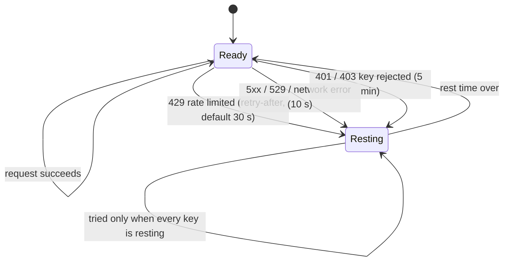

Order of keys for each request: start at the next key in rotation, Ready keys first, Resting keys last. A `400` (bad request) does not switch keys, because it would fail on every key.

---

## Part 3: Sequence diagrams

### 3.1 Client: log in, ask, renew

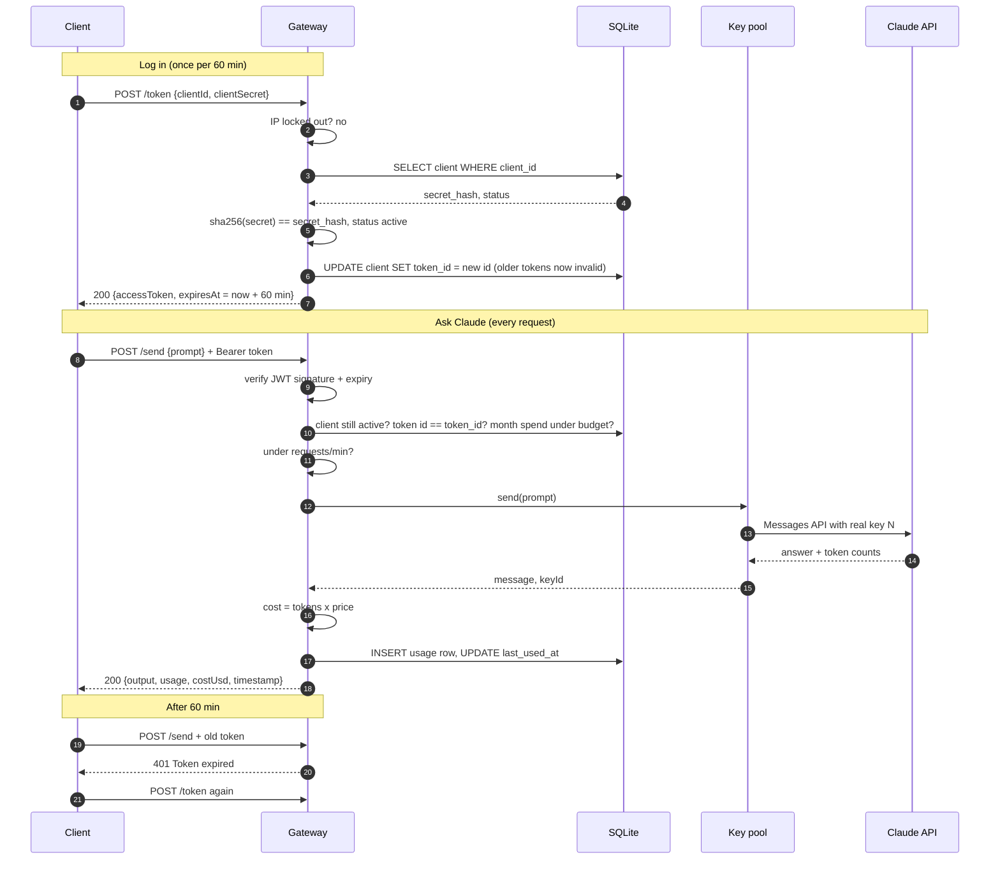

### 3.2 Admin: sign in with 2FA, create a client

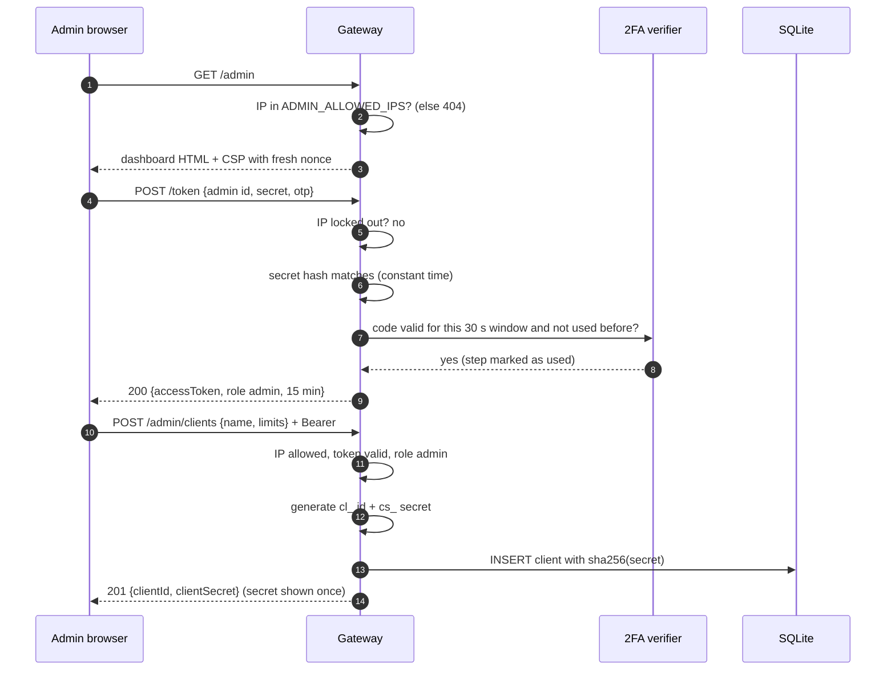

### 3.3 Failover when a real key is rate limited

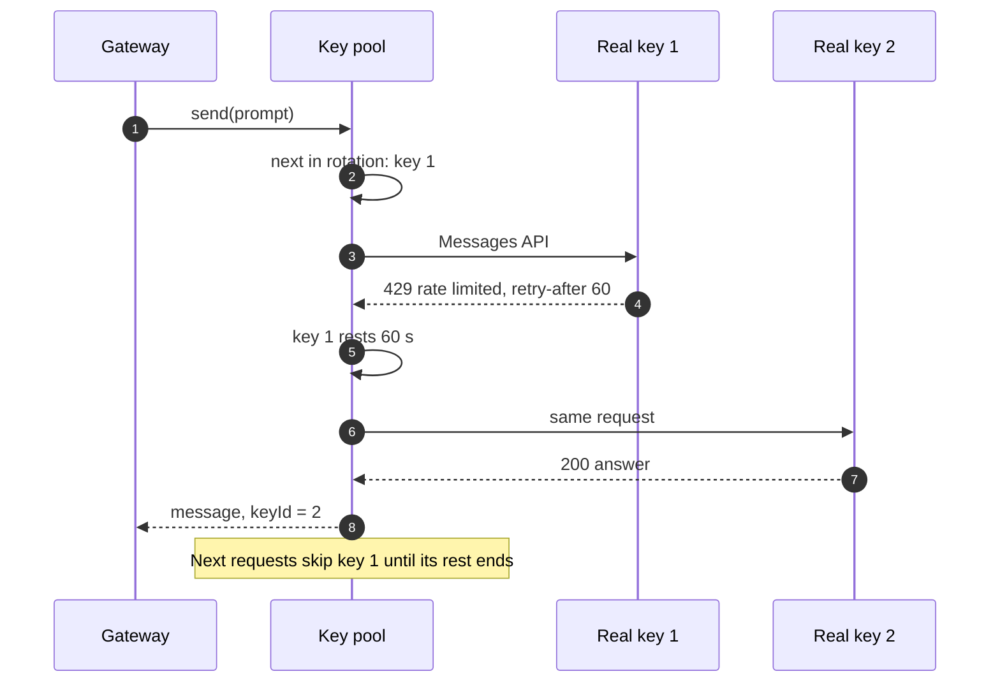

### 3.4 Password guessing is blocked

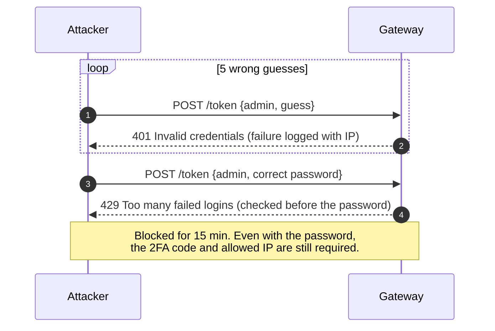
