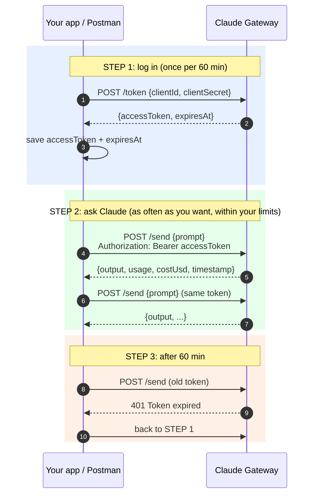
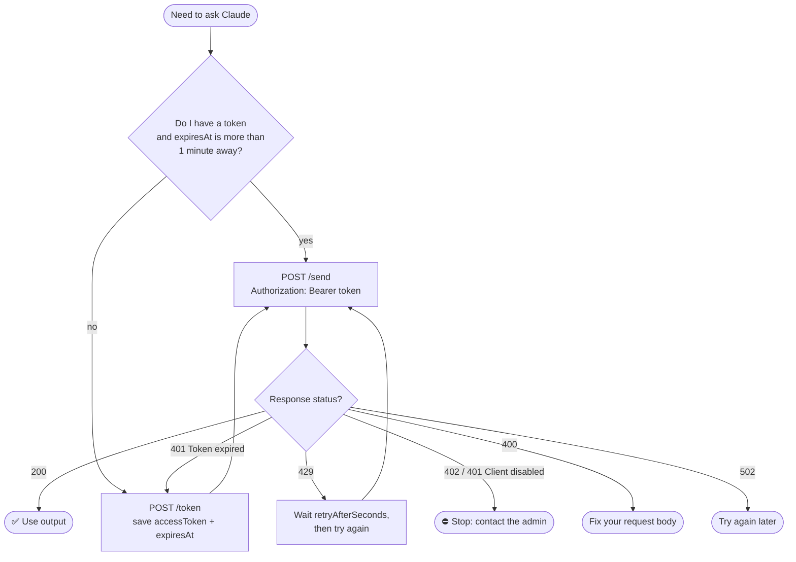

# Claude Gateway: Client Guide

This guide is for **people and apps that send prompts** to the company Claude Gateway.
You don't need an Anthropic account or API key. The gateway handles that.

---

## 1. What you get from the admin

| Item | Looks like | Keep it secret? |
|---|---|---|
| **Base URL** | `https://claude.parampreetsingh.dev/api/assistant` | No |
| **Client ID** | `cl_7f3a9c...` | Not really, but don't post it publicly |
| **Client secret** | `cs_Q2xhdWRl...` | **Yes. Treat it like a password.** |
| **Your limits** | e.g. $50 per month, 20 requests per minute | No |

Lost the secret? Ask the admin to **rotate** it. They can't look it up; only a hash is stored.

---

## 2. How it works in 30 seconds

1. **Log in:** send your client ID + secret to `/token`. You get an **access token** valid for **60 minutes**.
2. **Ask:** send prompts to `/send` with the token in the `Authorization` header. Reuse the same token for every request.
3. **Renew:** when the token is about to expire (or you get `401 Token expired`), log in again.



### What your code should do before every request



---

## 3. Quick start with curl

Replace `BASE`, `cl_...` and `cs_...` with your values.

```bash
BASE=https://claude.parampreetsingh.dev/api/assistant
```

**Step 1: get a token**

```bash
curl -X POST $BASE/token \
  -H 'Content-Type: application/json' \
  -d '{"clientId":"cl_...","clientSecret":"cs_..."}'
```

```json
{
  "accessToken": "eyJhbGciOiJIUzI1NiIsInR5cCI6IkpXVCJ9...",
  "tokenType": "Bearer",
  "role": "client",
  "expiresIn": 3600,
  "expiresAt": "2026-11-04T11:15:00.000Z"
}
```

**Step 2: ask Claude**

```bash
curl -X POST $BASE/send \
  -H 'Content-Type: application/json' \
  -H 'Authorization: Bearer eyJhbGciOi...' \
  -d '{"prompt":"Explain what an API is in 2 lines","systemPrompt":"You are a concise teacher."}'
```

```json
{
  "output": "An API is a set of rules that lets programs talk to each other...",
  "model": "claude-haiku-5-5",
  "stopReason": "end_turn",
  "usage": {
    "inputTokens": 24,
    "outputTokens": 61,
    "cacheWriteTokens": 0,
    "cacheReadTokens": 0,
    "totalTokens": 85,
    "costUsd": 0.000033
  },
  "timestamp": "2026-11-04T10:15:32.481Z",
  "durationMs": 1240
}
```

**Step 3: check your spend**

```bash
curl $BASE/me/usage -H 'Authorization: Bearer eyJhbGciOi...'
```

---

## 4. Quick start with Postman

1. **Token request**
   - `POST {{BASE}}/token`
   - Body → raw → JSON: `{"clientId":"cl_...","clientSecret":"cs_..."}`
   - Send, copy `accessToken`.
2. **Send request**
   - `POST {{BASE}}/send`
   - **Authorization** tab → Type **Bearer Token** → paste the token.
   - Body → raw → JSON: `{"prompt":"Hello"}`
3. After 60 minutes, repeat step 1 and paste the new token.

Tip: save `BASE`, `clientId` and `clientSecret` as Postman **environment variables** (mark the secret as *secret* type), so they aren't stored in the request itself.

---

## 5. Endpoint reference

All paths are relative to the base URL. Requests and responses are JSON. Send `Content-Type: application/json` on POST requests.

### 5.1 `POST /token`: log in

| | |
|---|---|
| Auth | none (your ID + secret are in the body) |
| Body | `clientId` (string, required), `clientSecret` (string, required) |

**200 response**

| Field | Type | Meaning |
|---|---|---|
| `accessToken` | string | Send it as `Authorization: Bearer <accessToken>` |
| `tokenType` | `"Bearer"` | |
| `role` | `"client"` | |
| `expiresIn` | number | Seconds until expiry (3600 = 60 min) |
| `expiresAt` | string | Expiry time, ISO 8601 UTC |

**Errors:** `401 Invalid credentials` (wrong ID or secret, **or** your client is disabled; the message is the same on purpose), `400` (body missing fields).

### 5.2 `POST /send`: ask Claude

| | |
|---|---|
| Auth | `Authorization: Bearer <accessToken>` |
| Body | `prompt` (string, required, not empty), `systemPrompt` (string, optional) |

- `prompt`: what you want to ask.
- `systemPrompt`: instructions for how Claude should behave (role, tone, format). If you leave it out, the gateway's default is used.
- Any other fields in the body are ignored.
- There's a maximum length for `prompt` + `systemPrompt` (ask the admin; default 50,000 characters each).

**200 response**

| Field | Type | Meaning |
|---|---|---|
| `output` | string | Claude's answer |
| `model` | string | Model that answered |
| `stopReason` | string | `end_turn` = finished normally; `max_tokens` = answer was cut off at the length limit |
| `usage.inputTokens` | number | Tokens in your prompt + system prompt |
| `usage.outputTokens` | number | Tokens Claude generated (includes its hidden reasoning, which is billed) |
| `usage.cacheWriteTokens` / `cacheReadTokens` | number | Usually 0 |
| `usage.totalTokens` | number | Sum of the above |
| `usage.costUsd` | number | What this request cost, in US dollars |
| `timestamp` | string | When Claude finished, ISO 8601 UTC |
| `durationMs` | number | How long Claude took, in milliseconds |

**422 response:** Claude declined the request (`"error": "Request declined by model"`). It still includes `usage`, because those tokens are billed.

### 5.3 `GET /me/usage`: your spend this month

| | |
|---|---|
| Auth | `Authorization: Bearer <accessToken>` |

```json
{
  "clientId": "cl_7f3a...",
  "name": "Priya - data team",
  "monthStart": "2026-11-01T00:00:00.000Z",
  "spentUsd": 1.2345,
  "requests": 87,
  "monthlyBudgetUsd": 50,
  "remainingUsd": 48.7655,
  "requestsPerMinute": 20
}
```

`monthlyBudgetUsd` / `requestsPerMinute` = `null` means no limit. Months are calendar months in **UTC**.

### 5.4 `GET /health`: is the gateway up

No auth. Returns `{"status":"ok", ...}`.

---

## 6. Errors and what to do

Every error has a JSON body with an `error` message.

| Status | `error` message | Why | What to do |
|---|---|---|---|
| 400 | (validation message) | Body is wrong, e.g. empty or missing `prompt` | Fix the request |
| 401 | `Invalid credentials` | Wrong ID/secret at `/token`, or client disabled | Check values; if correct, ask the admin |
| 401 | `Missing or invalid token` | No `Authorization` header, a typo, or a changed token | Send `Bearer <accessToken>` exactly as received |
| 401 | `Token expired` | Token is older than 60 min | Call `/token` again |
| 401 | `Token replaced by a newer login` | Someone (you, another copy of your app, or anyone with your secret) called `/token` again; only the newest token works | Use the newest token. If you didn't log in again, tell the admin: your secret may have leaked |
| 401 | `Client disabled` | Admin disabled your client | Ask the admin |
| 402 | `Monthly budget exceeded` | You've used your monthly budget (`budgetUsd`, `spentUsd` included) | Ask the admin to raise it, or wait for next month (UTC) |
| 403 | `Origin not allowed` | Called from a web page on a site that isn't approved | Ask the admin to add your site, or call from your backend |
| 403 | `Use a client account for this route` | Used an admin token on `/send` | Use a client ID + secret |
| 429 | `Too many failed logins. Try again later.` | 5 failed `/token` attempts from your IP in 15 min | Wait `retryAfterSeconds`; check your ID and secret |
| 429 | `Rate limit: N requests per minute` | You sent too many requests in the last minute | Wait `retryAfterSeconds` (also in the `retry-after` header) |
| 429 | `All real keys are rate limited, retry later` | Company-wide Anthropic limit hit | Wait ~30–60 s and retry |
| 502 | `Upstream AI error` | Claude/Anthropic failed | Retry later; if it keeps happening, tell the admin |

**Safe to retry automatically:** `401 Token expired` (after a new login), `429`, `502`. For `401 Token replaced by a newer login`, log in again once; if it keeps happening, two programs are sharing your client ID.
**Don't retry:** `400`, `401 Invalid credentials`, `401 Client disabled`, `402`, `403`.

---

## 7. Code examples

### 7.1 JavaScript / TypeScript (Node 18+)

```ts
const BASE = process.env.GATEWAY_URL!;          // e.g. https://claude.parampreetsingh.dev/api/assistant
const CLIENT_ID = process.env.GATEWAY_CLIENT_ID!;
const CLIENT_SECRET = process.env.GATEWAY_CLIENT_SECRET!;

let token: { value: string; expiresAt: number } | null = null;

async function getToken(): Promise<string> {
  // Reuse the token until 1 minute before it expires
  if (token && token.expiresAt - Date.now() > 60_000) return token.value;

  const res = await fetch(`${BASE}/token`, {
    method: "POST",
    headers: { "Content-Type": "application/json" },
    body: JSON.stringify({ clientId: CLIENT_ID, clientSecret: CLIENT_SECRET }),
  });
  if (!res.ok) throw new Error(`Login failed: ${res.status} ${(await res.json()).error}`);
  const body = await res.json();
  token = { value: body.accessToken, expiresAt: new Date(body.expiresAt).getTime() };
  return token.value;
}

export async function ask(prompt: string, systemPrompt?: string) {
  for (let attempt = 1; attempt <= 3; attempt++) {
    const res = await fetch(`${BASE}/send`, {
      method: "POST",
      headers: { "Content-Type": "application/json", Authorization: `Bearer ${await getToken()}` },
      body: JSON.stringify({ prompt, systemPrompt }),
    });
    const body = await res.json();

    if (res.ok) return body; // { output, usage, timestamp, ... }
    if (res.status === 401 && body.error === "Token expired") { token = null; continue; }
    if (res.status === 429) { await sleep((body.retryAfterSeconds ?? 30) * 1000); continue; }
    if (res.status === 502) { await sleep(2000 * attempt); continue; }
    throw new Error(`${res.status}: ${body.error ?? body.message}`); // 400, 402, 403, other 401
  }
  throw new Error("Gave up after 3 attempts");
}

const sleep = (ms: number) => new Promise((r) => setTimeout(r, ms));

// Usage
const r = await ask("Summarize: the meeting moved to Friday.", "Answer in one sentence.");
console.log(r.output, `($${r.usage.costUsd})`);
```

### 7.2 Python (requests)

```python
import os, time, requests
from datetime import datetime, timezone

BASE = os.environ["GATEWAY_URL"]                # e.g. https://claude.parampreetsingh.dev/api/assistant
CLIENT_ID = os.environ["GATEWAY_CLIENT_ID"]
CLIENT_SECRET = os.environ["GATEWAY_CLIENT_SECRET"]

_token = {"value": None, "expires_at": 0.0}

def get_token() -> str:
    # Reuse the token until 1 minute before it expires
    if _token["value"] and _token["expires_at"] - time.time() > 60:
        return _token["value"]
    r = requests.post(f"{BASE}/token", json={"clientId": CLIENT_ID, "clientSecret": CLIENT_SECRET}, timeout=30)
    r.raise_for_status()
    body = r.json()
    _token["value"] = body["accessToken"]
    _token["expires_at"] = datetime.fromisoformat(body["expiresAt"].replace("Z", "+00:00")).timestamp()
    return _token["value"]

def ask(prompt: str, system_prompt: str | None = None) -> dict:
    payload = {"prompt": prompt, **({"systemPrompt": system_prompt} if system_prompt else {})}
    for attempt in range(1, 4):
        r = requests.post(f"{BASE}/send", json=payload,
                          headers={"Authorization": f"Bearer {get_token()}"}, timeout=600)
        body = r.json()
        if r.ok:
            return body  # {"output", "usage", "timestamp", ...}
        if r.status_code == 401 and body.get("error") == "Token expired":
            _token["value"] = None
            continue
        if r.status_code == 429:
            time.sleep(body.get("retryAfterSeconds", 30))
            continue
        if r.status_code == 502:
            time.sleep(2 * attempt)
            continue
        raise RuntimeError(f"{r.status_code}: {body.get('error') or body.get('message')}")  # 400, 402, 403, other 401
    raise RuntimeError("Gave up after 3 attempts")

if __name__ == "__main__":
    res = ask("Give me 3 names for a coffee shop.", "Be creative, one line each.")
    print(res["output"], f"(${res['usage']['costUsd']})")
```

---

## 8. Rules and good practice

**Security**
- ⛔ **Never put the client secret in browser or mobile app code.** Anyone can read it there. Keep it on a server, in environment variables or a secrets manager.
- ⛔ Never commit the secret or a token to git, or paste them into chat, tickets or websites.
- If you think your secret leaked, tell the admin right away. They can rotate it, and disable your client instantly if needed.
- Use `https://` for the base URL outside your own machine.

**Tokens**
- **Only one token works at a time.** Each `/token` call cancels the token issued before it. Reuse one token for all requests during its 60 minutes; don't call `/token` before every `/send`.
- Renew about 1 minute **before** `expiresAt` to avoid a failed request at the boundary.
- Running several copies of your app? Ask the admin for **one client per copy** (or share one token between them). If each copy logs in with the same client ID, they keep cancelling each other's tokens.

**Cost**
- Every response tells you its `costUsd`. Check `/me/usage` to see your monthly total.
- Shorter prompts and asking for shorter answers cost less.
- Requests that fail on the gateway side (`502`) cost nothing.

**Timeouts**
- Long answers can take a while. Allow at least **60 seconds** (up to 10 minutes for very long outputs) before your HTTP client gives up.

---

## 9. FAQ

**Can I see which Anthropic key or model was used?** The model is in the `model` field. The key is internal; the admin can see it.

**Does the gateway keep my prompts?** No. It stores only token counts, cost, timing and status for each request, not the text.

**Can I have a conversation (multiple turns)?** Each `/send` is independent; Claude doesn't remember earlier requests. To continue a conversation, include the relevant earlier text in your `prompt`.

**Can I pick the model or settings (temperature, etc.)?** Not per request. The admin sets the model and settings for the whole gateway.

**My answer ends mid-sentence.** `stopReason` is probably `max_tokens`: the answer hit the length limit. Ask for a shorter answer, or ask the admin about the limit.

**Who do I contact?** Your gateway admin: _<add name / channel here>_.
