# Claude Gateway: Plan

Status: **built** (all steps in section 10). Decisions from section 11 are applied: requests spread across all real keys automatically with failover, and per-client limits.

---

## 0. The words used in this plan

| Word | What it is | How many |
|---|---|---|
| **Admin** | The one person who manages the gateway. Logs in with the admin ID + secret from `.env`. | **1** |
| **Client** (virtual key) | A name + `clientId` + `clientSecret` that the admin creates and gives to a person or app. | **Unlimited** |
| **Real key** | An actual Anthropic API key (`sk-ant-...`). Only the gateway knows them. Clients never see them. | **3** |
| **Access token** | A temporary pass the gateway gives a client after it logs in. Valid **60 minutes**. | 1 per login |

---

## 1. Big picture

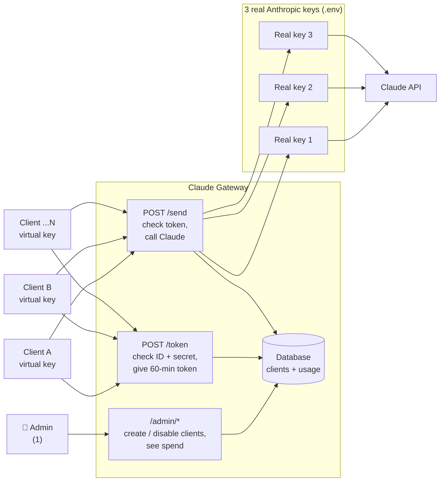

In one sentence: **clients log in with their virtual key, get a 60-minute token, use the token to ask Claude, and the gateway pays with one of the 3 real keys and records the cost against that client.**

---

## 2. Setup: admin creates a client

This happens once per person/app.

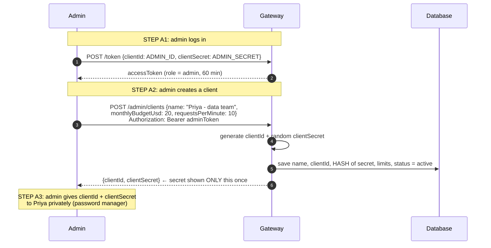

- The database never stores the secret itself, only a hash. If the admin loses it, they create a new secret (rotate), they can't look it up.
- The admin can later **disable** a client. It stops working on its very next request (see step 5 of the main flow).

---

## 3. ⭐ Main flow: a client sends a request

### 3.1 The whole journey, step by step

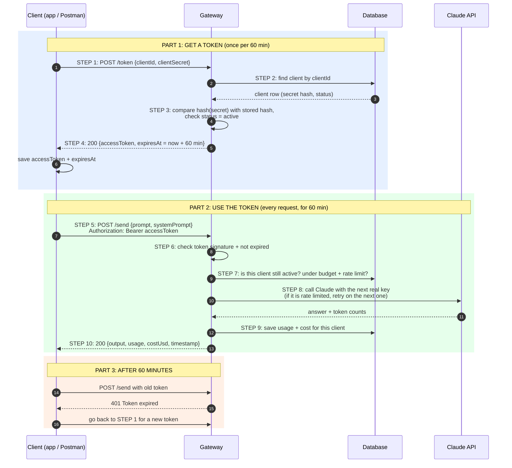

### 3.2 What the gateway checks on `POST /send` (in order)

Each check can stop the request. Nothing reaches Claude until all pass.

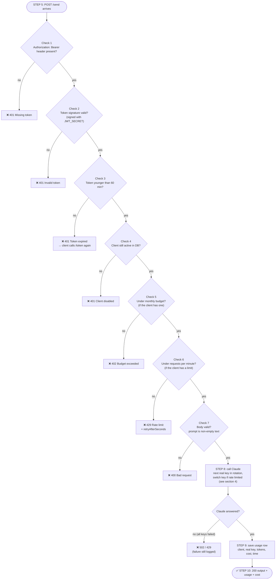

> **Why check the DB in Check 4 when the token is already valid?**
> A token alone can't be cancelled; it's valid until it expires. Checking the client's status on each request means that when the admin disables a client, it is **locked out immediately**, not up to 60 minutes later. It's one fast DB lookup.

### 3.3 What `POST /token` checks

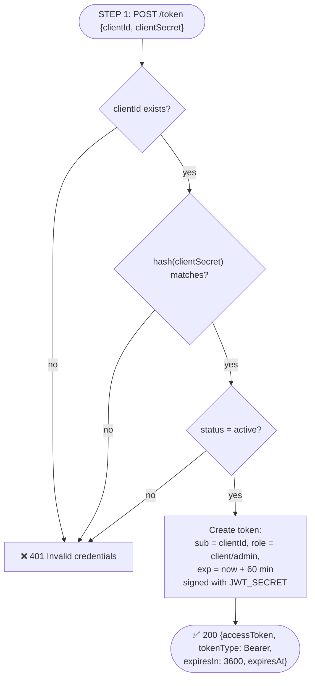

Same error message for all three failures on purpose: an attacker can't learn whether a `clientId` exists.

### 3.4 The 60-minute timeline of one token

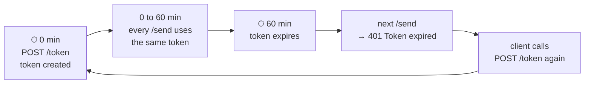

No refresh tokens: after 60 minutes the client simply logs in again with its ID + secret. (This removes the `/refresh` code that exists today.)

### 3.5 What the client's code does (client side)

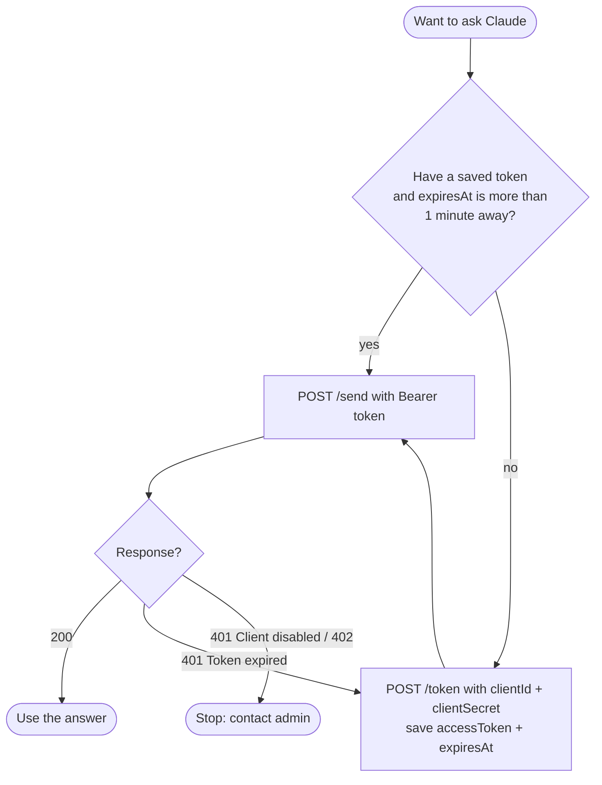

Getting a new token one minute **before** expiry avoids a failed request at the 60-minute mark.

---

## 4. The 3 real Anthropic keys: automatic spread + failover

Stored only in the gateway's `.env`:

```
REAL_KEY_1=sk-ant-...
REAL_KEY_2=sk-ant-...
REAL_KEY_3=sk-ant-...
```

Clients are **not** tied to a key. Every request takes the **next key in turn** (round robin), so load spreads evenly across all 3.

### 4.1 Normal case: round robin

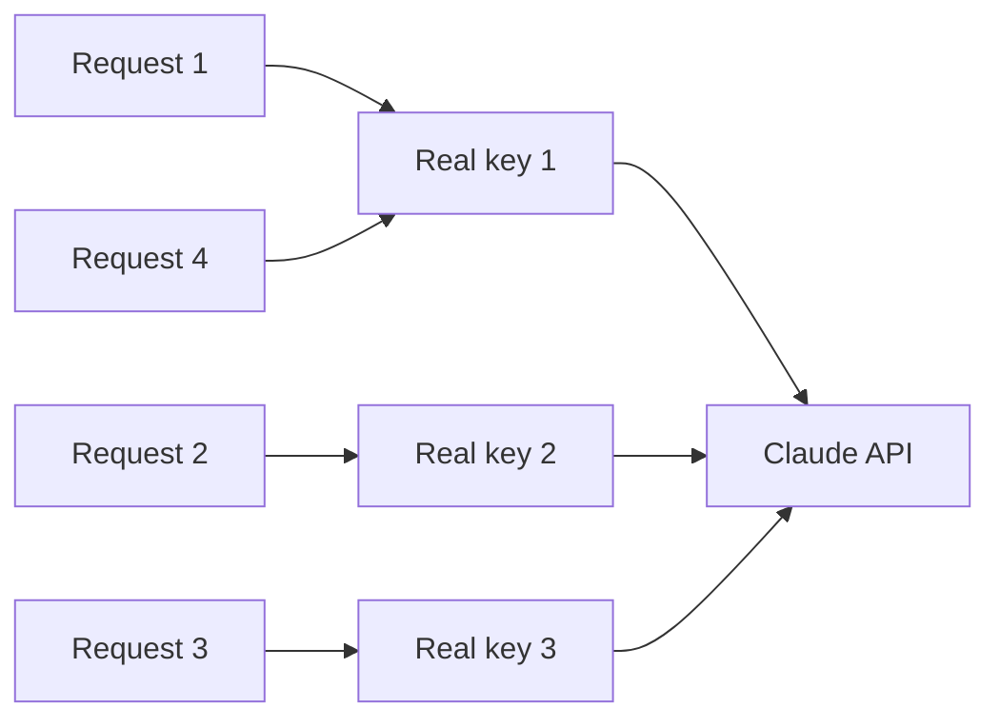

### 4.2 When a key is rate limited: switch and rest it

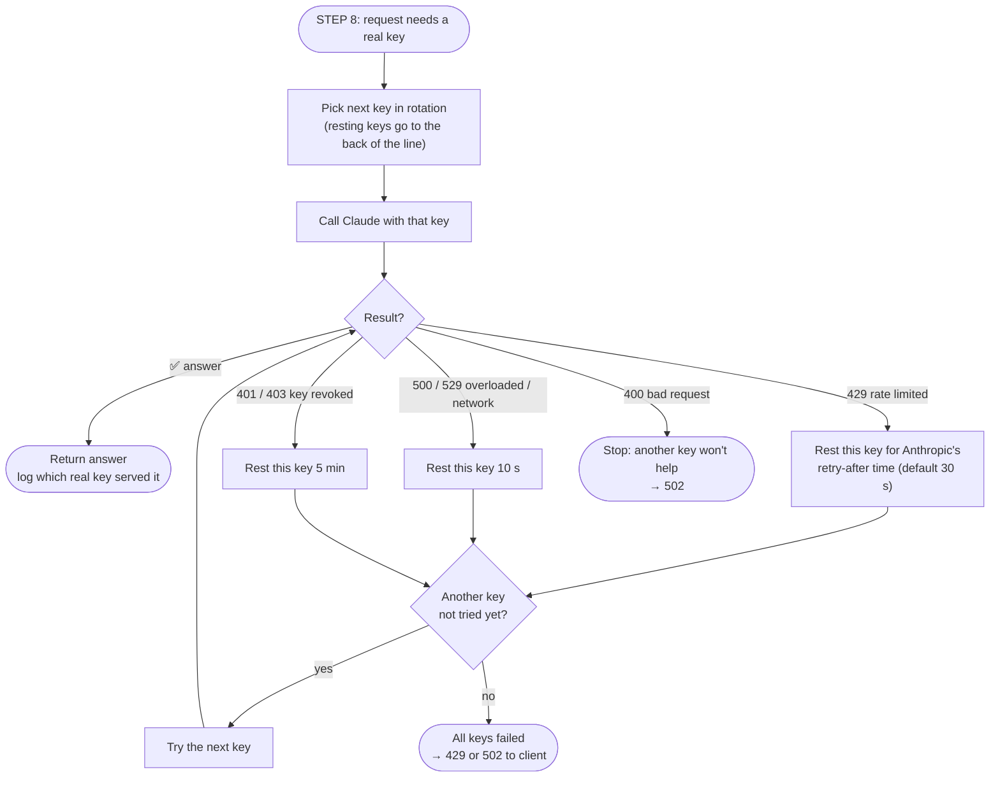

- A resting key is skipped by new requests until its rest time ends, so one throttled key doesn't slow everyone down.
- If **all** keys are resting, they're still tried (oldest first) rather than refusing outright.
- The admin dashboard shows each key's requests, spend, errors, and whether it is resting right now.

## 5. Spend tracking

After every Claude call (STEP 9), one row is saved:

| client | real key | model | input tokens | output tokens | cost USD | time | status |
|---|---|---|---|---|---|---|---|
| Priya - data team | 2 | claude-opus-5-5 | 420 | 1 180 | 0.0253 | 10:15:32 | 200 |

`cost = input × input price + output × output price` (price table in code, per model).

The admin can then see:

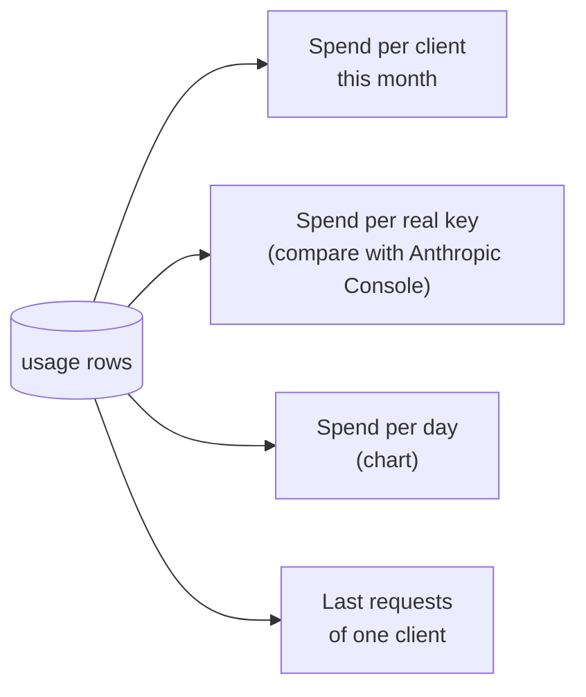

- `GET /admin/usage?groupBy=client|realKey|day` returns these numbers.
- A simple `/admin` web page shows them as a table + chart (later phase).
- Each client can see its own spend with `GET /me/usage`.

### 5.1 Limits per client

| Limit | Set where | When exceeded |
|---|---|---|
| Monthly budget (USD) | Admin, per client (`monthlyBudgetUsd`) or default from `DEFAULT_MONTHLY_BUDGET_USD` | `402 Budget exceeded` until next month or admin raises it |
| Requests per minute | Admin, per client (`requestsPerMinute`) or default from `DEFAULT_REQUESTS_PER_MINUTE` | `429` with `retryAfterSeconds` |
| Max output per request | `.env` `CLAUDE_MAX_TOKENS` | caps the cost of one call |
| Whole company | Anthropic Console spend limit on the workspace | Anthropic refuses calls |

`null` / empty = unlimited. Changes apply on the client's **next** request, no restart.

---

## 6. What is stored

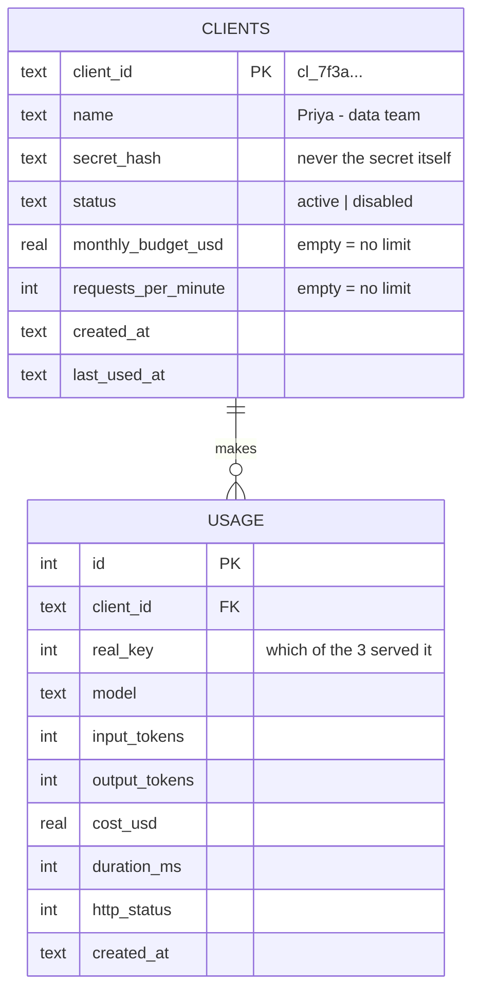

- Database: SQLite (one file, built into Node 26, nothing extra to install).
- The admin is **not** in the database; their ID + secret live in `.env`.
- Prompts and answers are **not** stored.

`.env` after the change:

```
ADMIN_ID=admin
ADMIN_SECRET=<long random>
JWT_SECRET=<long random>
TOKEN_TTL_MINUTES=60
REAL_KEY_1=sk-ant-...
REAL_KEY_2=sk-ant-...
REAL_KEY_3=sk-ant-...
DEFAULT_MONTHLY_BUDGET_USD=     # empty = unlimited
DEFAULT_REQUESTS_PER_MINUTE=    # empty = unlimited
CLAUDE_MODEL=claude-opus-5-5
... (other Claude settings as today)
```

---

## 7. Endpoints

| # | Method | Path | Who | What |
|---|---|---|---|---|
| 1 | GET | `/health` | anyone | is the server up |
| 2 | POST | `/token` | admin + clients | ID + secret → 60-min token |
| 3 | POST | `/send` | clients | ask Claude (admin creates a client for itself to test) |
| 4 | GET | `/me/usage` | clients | own spend this month |
| 5 | POST | `/admin/clients` | admin | create client → returns secret once |
| 6 | GET | `/admin/clients` | admin | list clients (no secrets) |
| 7 | PATCH | `/admin/clients/:id` | admin | rename, budget, requests/min, disable/enable |
| 8 | POST | `/admin/clients/:id/rotate-secret` | admin | new secret, old one stops working |
| 9 | GET | `/admin/usage` | admin | spend per client / real key / day / model |
| 10 | GET | `/admin/usage/:id` | admin | last 50 requests of one client |
| 11 | GET | `/admin/keys` | admin | real keys: ready or resting |
| 12 | GET | `/admin` | admin | dashboard page (logs in with admin ID + secret) |

All under the base path `/api/assistant` as today.

---

## 8. Every error a client can get

| Code | Message | Meaning | What to do |
|---|---|---|---|
| 400 | Bad request | Body is wrong (e.g. empty prompt) | Fix the request |
| 401 | Invalid credentials | Wrong clientId/secret, or client disabled, at `/token` | Check credentials / ask admin |
| 401 | Missing / invalid token | No token or a changed token | Call `/token` |
| 401 | Token expired | Older than 60 min | Call `/token` again |
| 401 | Client disabled | Admin disabled you | Ask admin |
| 402 | Budget exceeded | Monthly budget used up | Ask admin |
| 403 | Forbidden | Client token used on `/admin/*` | Use the admin account |
| 429 | Rate limit: N requests per minute | Client went over its own requests/min | Wait `retryAfterSeconds` |
| 429 | All real keys are rate limited | All 3 Anthropic keys are throttled | Wait and retry |
| 502 | Upstream AI error | Anthropic failed | Retry later; admin checks logs |

---

## 9. What changes from today's code

| Today | After |
|---|---|
| One `CLIENT_ID` / `CLIENT_SECRET` in `.env` | Unlimited clients in the database, created by the admin |
| One `ANTHROPIC_API_KEY` | 3 real keys, requests spread across them, auto-switch on rate limit |
| `/refresh` + refresh tokens | **Removed**: log in again after 60 min |
| No record of who spent what | Every request saved with client, real key, tokens, cost |
| Origin check on every request | Optional (only useful for browser frontends) |
| Disabling a client: edit `.env` + restart | Admin API, effective on the next request |

---

## 10. Build steps

| Step | Build | Test that proves it works |
|---|---|---|
| 1 | SQLite database + `clients` and `usage` tables | Server starts and creates the file |
| 2 | Admin login via `/token` using `.env` admin creds; `role` inside the token | Admin gets a token; client token on `/admin/*` → 403 |
| 3 | `/admin/clients` create / list / update / rotate-secret | Create a client, get its secret once |
| 4 | `/token` for clients from the database; remove `/refresh` | New client gets a 60-min token; wrong secret → 401 |
| 5 | `/send`: checks 1 to 7 + key pool with failover | Disabled client → 401 on next request; rate-limited key → next key |
| 6 | Save usage + cost after each call; `costUsd` in response; `/me/usage` | Usage row appears with correct cost |
| 7 | `/admin/usage` + monthly budget (check 5) | Over budget → 402 |
| 8 | `/admin` dashboard page | Admin sees spend per client and per real key |
| 9 | README + diagrams updated, deploy notes | Someone new can run it from the README |

---

## 11. Decisions (resolved)

| # | Question | Decision |
|---|---|---|
| 1 | How to use the 3 real keys | **Spread automatically** (round robin) + switch to the next key when one is rate limited |
| 2 | Limits | **Per-client monthly budget + requests per minute**, with defaults from `.env` |
| 3 | Admin storage | `.env` (exactly 1 admin) |
| 4 | Dashboard | Built: `/api/assistant/admin` |
| 5 | Origin check | Browsers from other sites blocked unless in `ALLOWED_ORIGINS`; scripts/Postman (no Origin) rely on the token |
